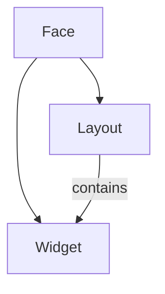

# Faces Driven UI System

📖 **Overview**

The **Faces Driven UI System** is the core module for dynamic, face-based widget rendering in TwinFaces. It enables flexible UI composition by interpreting backend-provided Face definitions, which describe layouts, widgets, and their relationships. Each Face acts as a blueprint for rendering a specific UI structure or widget, allowing the frontend to adapt to new requirements without code changes.

- **Face**: A backend-defined entity describing a layout or widget, including its type, configuration, and children.
- **Dynamic Rendering**: UI is built at runtime by resolving Face definitions into React components.

---

🧠 **Concepts & Terminology**

### Core Concepts

- **Face**: A backend-defined UI entity that can represent a layout or a widget. It is the main building block for dynamic UI.
- **Layout**: A Face that arranges widgets (e.g., pages, tabs). Layouts contain references to widget Faces.
- **Widget**: A Face that renders a specific UI element (e.g., table, editor). Widgets are the interactive or display components within layouts.

> **Note (TWINS-943):** the historical `TW`/`WT` split was eliminated — all widgets are now unified under the `WT` prefix with a continuous numbering (`WT001`–`WT010`). Every widget endpoint requires the `twinId` query param, and every widget DTO exposes `pointedTwinId` — the twin the widget actually works with. Always use `pointedTwinId` (not the request `twinId`) for the widget's data calls.

#### UML Diagram

Below is a UML-style diagram (using Mermaid) that shows the same relationships in a more visual way:



**What this means:**

- `Layout` and `Widget` are both types of `Face` (they inherit from Face).
- A `Layout` can include (contain) many `Widget` components.

### Other Concepts

- **Renderer**: A component that resolves a Face and renders the appropriate React component.
- **Component Type Prefixes**:
  - `PG`: Page Layout (e.g., `PG001`)
  - `WT`: Widget (e.g., `WT001`)
  - `TC`: Twin Create (e.g., `TC001`)

---

📁 **Folder Structure**

### `src/widgets/faces` Tree View

```
src/widgets/faces/
├── components/
│   ├── widgets-container.tsx
│   ├── status-alert.tsx
│   └── ...etc (utility and helper components for faces)
├── layouts/
│   ├── renderer.tsx
│   ├── types.ts
│   └── views/
│       ├── pg001.tsx
│       ├── pg002.tsx
│       └── ...etc (other layout implementations)
├── widgets/
│   ├── renderer.tsx
│   ├── types.ts
│   └── views/
│       ├── tc001/
│       ├── wt001/
│       ├── wt002/
│       ├── wt003/
│       ├── wt004/
│       ├── wt005.tsx
│       ├── wt005/
│       └── ...etc (other widget implementations)
```

#### Key Folders & File Responsibilities

- **components/**
  - `widgets-container.tsx`: Renders a list of widgets for a given layout.
  - `status-alert.tsx`: Standardized alert component for error/info/success states.
  - Other utility/helper components used by faces (e.g., loading indicators, error boundaries, etc.). Place only face-specific helpers here.

- **layouts/**
  - `renderer.tsx`: Main entry for resolving and rendering layout faces.
  - `types.ts`: Type definitions for layout faces.
  - `views/`: Implementations of specific layout types (e.g., `pg001.tsx`, `pg002.tsx`, etc.).

- **widgets/**
  - `renderer.tsx`: Main entry for resolving and rendering widget faces.
  - `types.ts`: Type definitions for widget faces.
  - `views/`: Implementations of specific widget types:
    - `wt005.tsx`: Simple single-file widget implementation.
    - `tc001/`: Twin Create widgets (e.g., `tc001-form.tsx`).
    - `wt001/`, `wt004/`, `wt006/`: Subfolders for complex widgets, each containing main logic and supporting files (e.g., `wt006.tsx`, `utils.ts`).

---

🔄 **Runtime Flow**

1. **LayoutRenderer**: Receives a layout Face ID, fetches the Face, and resolves the layout type (e.g., `PG001`).
2. **Layout**: Renders containers for widgets as defined by the Face.
3. **WidgetsContainer**: Iterates over widget Faces and delegates rendering.
4. **WidgetRenderer**: Resolves the widget type (e.g., `WT001`, `WT004`) and renders the corresponding component.
5. **WT Components**: Implement the actual widget logic and UI.

```
LayoutRenderer → Layout → WidgetsContainer → WidgetRenderer → WT Component
```

---

🧩 **Widget Implementations**

| Widget Name | File Path                             | Notes                     |
| ----------- | ------------------------------------- | ------------------------- |
| WT001       | `faces/widgets/views/wt001/wt001.tsx` | Twins table               |
| WT002       | `faces/widgets/views/wt002/wt002.tsx` | Twin create buttons       |
| WT003       | `faces/widgets/views/wt003/wt003.tsx` | Alert/messages widget     |
| WT004       | `faces/widgets/views/wt004/wt004.tsx` | Twin image/media gallery  |
| WT005       | `faces/widgets/views/wt005.tsx`       | Twin i18n field accordion |
| WT006       | `faces/widgets/views/wt006/wt006.tsx` | Twin field view/edit      |
| WT007       | `faces/widgets/views/wt007/wt007.tsx` | Twin transition buttons   |
| WT010       | `faces/widgets/views/wt010/wt010.tsx` | Twin class change         |
| TC widgets  | `faces/widgets/views/tc001/`          | Twin create widgets       |

---

⏳ **Suspense Usage**

- Use React Suspense for async widget and layout loading.
- Provide skeletons from `features/ui/skeletons/` for loading states.
- Always wrap async components with fallback skeletons for best UX.

---

[How to Add a New Widget to the Faces Driven UI System](add-widget.md)
